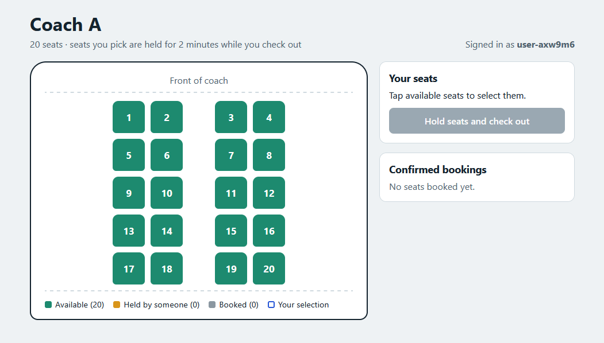
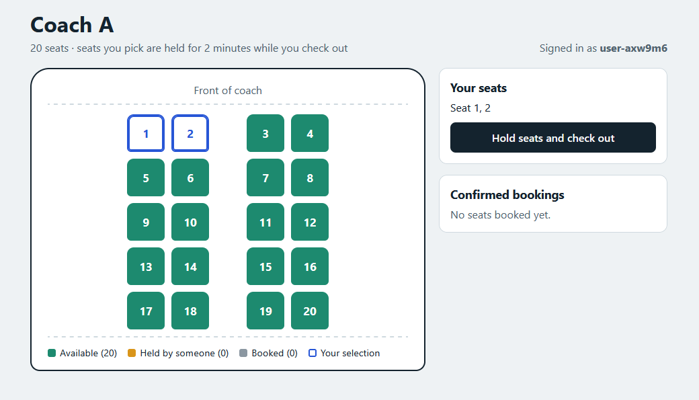
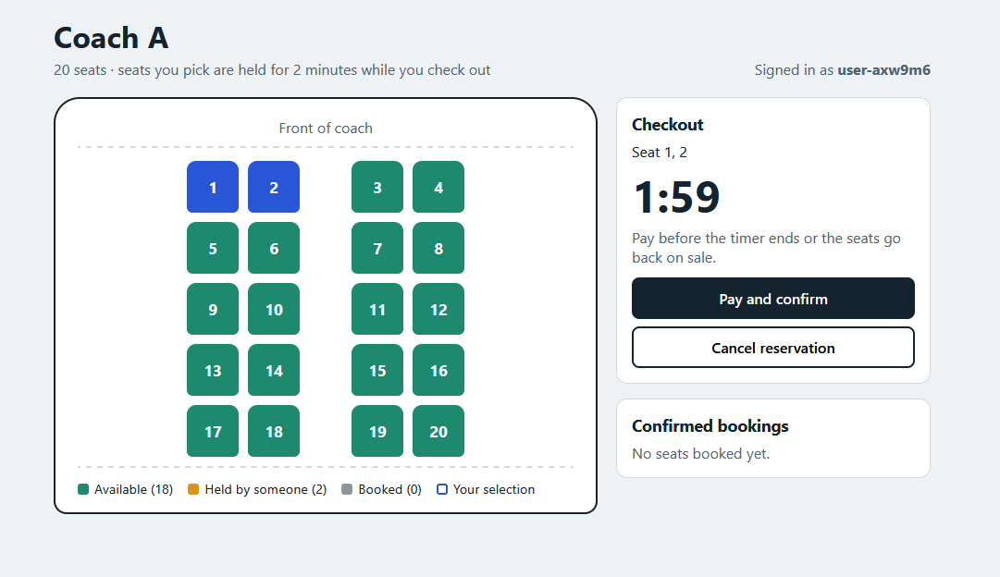
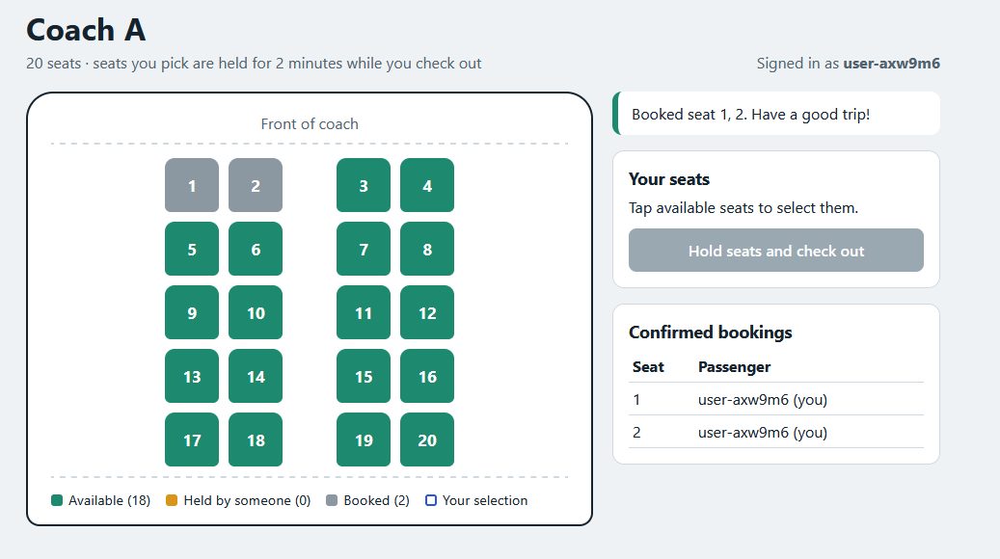
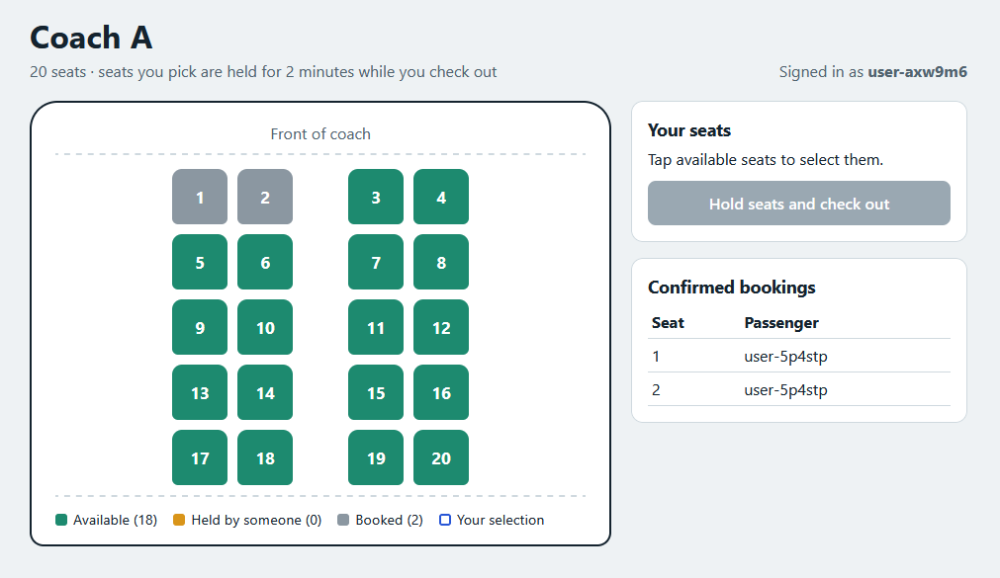
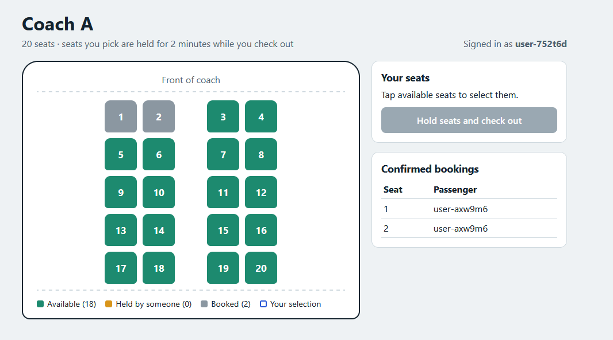

# Train Seat Booking

One coach, 20 seats, 100 passengers racing for them. Seats are locked for 2 minutes during checkout,
confirmed with a simulated payment, and the system guarantees **no more than 20 confirmed seats and no seat
ever assigned to two users**, even under simultaneous requests.

| Layer | Technology |
|---|---|
| Frontend | React 18 + Vite |
| Backend | Java 17, Spring Boot 3.2, Spring Data JPA / Hibernate, Flyway |
| Database | PostgreSQL 16 |
| API | REST, Controller → Service → Repository |

## Run it locally

**Prerequisites:** Java 17 or newer, Maven 3.9 or newer, Node.js 18 or newer, and Docker Desktop with Docker Compose.
The steps below use PowerShell and assume you opened this repository's root folder in VS Code. Open a separate
integrated terminal for each service; leave the backend and frontend terminals running while you use the app.

### 1. Start PostgreSQL

In a terminal at the repository root, create the local environment file on first run:

```powershell
if (-not (Test-Path .env)) { Copy-Item .env.example .env }
```

Open `.env`, set a local `DB_PASSWORD`, save it, then start PostgreSQL:

```powershell
docker compose up -d
```

### 2. Start the backend

Open a **new terminal** at the repository root and run:

```powershell
cd backend
mvn spring-boot:run
```

Flyway creates the schema and seeds the 20 seats on first startup. Keep this terminal open. The API is at
`http://localhost:8080`.

### 3. Start the frontend

Open another **new terminal** at the repository root and run:

```powershell
cd frontend
npm install
npm run dev
```

Open `http://localhost:5173`. `npm install` is needed after cloning (and again if dependencies change). Open the app in
two browser tabs to act as two passengers; each tab gets its own user ID.

To stop the app, press **Ctrl+C** in the backend and frontend terminals. To stop PostgreSQL while preserving its data,
run `docker compose down` from the repository root. `docker compose down -v` also deletes the database volume and all
demo bookings.

The backend reads `DB_PASSWORD` (and optional `DB_HOST`, `DB_PORT`, `DB_NAME`, `DB_USER`) from the root `.env` file or
environment variables. `.env` is ignored by Git; do not commit real credentials.

## Tests

```bash
cd backend
mvn test
```

Run these commands from a terminal at the repository root. The tests need Docker because Testcontainers starts a
throw-away PostgreSQL instance.

- `ConcurrentBookingTest` – 100 threads released at the same instant: 100 users / 20 seats → exactly 20 bookings;
  100 users / 1 seat → exactly 1; random overlapping multi-seat requests → no duplicates, never more than 20.
- `ReservationExpiryTest` – an expired lock cannot be confirmed (HTTP 410) and the seat becomes available again.
- `BookingFlowTest` – lock → confirm, locked/booked seat rejection, cancel, wrong-owner rejection.

### Concurrency demo against the running app

```bash
node scripts/concurrency-test.mjs
```

Fires 100 parallel HTTP booking attempts in three scenarios and prints PASS/FAIL for: confirmed seats ≤ 20, no seat
booked twice, seat map matches bookings table. **It calls `POST /api/admin/reset` between scenarios and clears the
demo bookings. Run it only against a disposable local database.** The endpoint is for demo/testing only (see
`app.demo-reset-enabled`). You can also verify directly in SQL:

```sql
SELECT count(*) AS bookings, count(DISTINCT seat_number) AS distinct_seats FROM bookings;  -- both <= 20
```

## API

Base URL `http://localhost:8080/api` · Postman collection: `docs/postman_collection.json`

| Method & path | Body | Success | Errors |
|---|---|---|---|
| `GET /seats` | – | `200` list of `{seatNumber, status: AVAILABLE\|LOCKED\|BOOKED, lockedUntil}` | – |
| `POST /reservations` | `{userId, seatNumbers:[..]}` | `201` `{reservationId, seatNumbers, expiresAt, secondsRemaining, status}` | `409 SEAT_UNAVAILABLE` (with `unavailableSeats`), `400` validation / unknown seat |
| `GET /reservations/{id}` | – | `200` reservation (status `ACTIVE`/`CONFIRMED`/`CANCELLED`/`EXPIRED`) | `404` |
| `POST /reservations/{id}/confirm` | `{userId}` | `200` reservation with status `CONFIRMED` | `410 RESERVATION_EXPIRED`, `403` not owner, `409` cancelled, `404` |
| `POST /reservations/{id}/cancel` | `{userId}` | `200` status `CANCELLED`, seats released | `409` already confirmed, `410` expired, `403`, `404` |
| `GET /bookings` | – | `200` confirmed bookings (booking history) | – |
| `POST /admin/reset` | – | `204` (demo/testing only) | `404` when disabled |

Errors look like `{"error":"SEAT_UNAVAILABLE","message":"Seat(s) 3 cannot be reserved: ...","unavailableSeats":[3],"timestamp":"..."}`.

## Database schema

`backend/src/main/resources/db/migration/V1__init.sql` (applied automatically by Flyway):

- `seats` – exactly 20 rows (`seat_number` 1–20), `status`, `reservation_id`, `locked_until`; a CHECK constraint keeps status and lock fields consistent.
- `reservations` + `reservation_seats` – a checkout attempt and the seats it holds, with `expires_at` and status.
- `bookings` – confirmed bookings with **`UNIQUE(seat_number)`** and a foreign key to `seats`.

## How duplicate bookings and race conditions are prevented

1. **One row per seat, locked with `SELECT … FOR UPDATE`.** Reserving, confirming and cancelling all run in a single
   transaction that first takes pessimistic row locks on the seats involved. A competing request for the same seat
   waits for the first transaction to commit, then sees the committed state and is rejected with `409`.
2. **Lock ordering.** Seats are always locked in ascending seat order (and a reservation row before its seats), so
   concurrent multi-seat requests queue up instead of deadlocking.
3. **All-or-nothing.** If any requested seat is unavailable, no seat is locked and the response lists the unavailable ones.
4. **Expiry is checked against the clock, not just the sweeper.** A `LOCKED` seat whose `locked_until` has passed is
   treated as available, and `confirm` rejects expired reservations with `410`. A scheduled job additionally releases
   expired locks every 5 s, so correctness never depends on the job's timing.
5. **Database constraints as a safety net.** `bookings.seat_number` is `UNIQUE` and references the 20 seat rows, so even
   a bug in application code could not create a 21st booking or a double booking.
6. `confirm` and `cancel` are idempotent for repeated calls by the same owner, and owners are checked (`403`).

## Demonstration checklist (maps to the assignment)

1. Select seats and press **Hold seats and check out** – seats turn blue for you and amber for other tabs; the timer counts down from 2:00.
2. **Pay and confirm** – seats turn grey (booked) and appear under *Confirmed bookings*.
3. **Cancel reservation**, or wait 2:00 – the seat returns to green.
4. Reserve a locked/booked seat from the API (`POST /reservations` in Postman or curl) – you get `409 SEAT_UNAVAILABLE`; confirming after expiry gives `410`.
5. Run `node scripts/concurrency-test.mjs` and `mvn test` – ≤ 20 bookings, no duplicates.

## Screenshots

Screenshots of the seat map, selection, reservation timer, confirmation, and booked-seat states:

### Seat map



### Selected seats



### Reservation countdown



### Booking confirmed



### Booked seats



### Another passenger's view



## Verification and AI disclosure

The app was built and run locally. The Node concurrency demo passed all three scenarios: 20 winners when 100 users
competed for the 20 seats, one winner when 100 users competed for the same seat, and no duplicate bookings or
inventory overflow in the overlapping multi-seat scenario. The Maven integration tests are included; run `mvn test`
as described above to execute them.

Claude (Anthropic) assisted with project scaffolding and code generation from the assignment brief. OpenAI Codex
assisted with local setup troubleshooting, concurrency-demo execution, and README review. The project author should
review this disclosure and make sure it accurately reflects the tools used and work performed.

- **Backend:** the Spring Boot application, including the entities, repositories, service layer, REST controller,
  error handling and the scheduled lock-expiry job.
- **Database:** the Flyway schema migration.
- **Frontend:** the React app.
- **Tests and scripts:** the Testcontainers integration tests and the Node concurrency script.
- **Documentation:** the README and the Postman collection.


## Project layout

```
backend/    Spring Boot app (controller, service, repository, domain, dto, exception) + tests
frontend/   React app (Vite)
scripts/    concurrency-test.mjs
docs/       Postman collection and screenshots
docker-compose.yml, .env.example
```

## Assumptions

- No authentication (a bonus item): the frontend generates a per-tab `userId`, and the backend only lets that id confirm/cancel its own reservation.
- One reservation can hold up to 20 seats; a user may hold several reservations at once.
